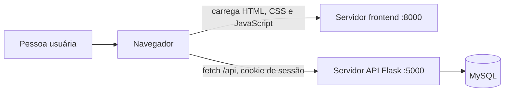

# TrailUp

## Apresentação do projeto

O **TrailUp** é uma aplicação web para descobrir trilhas, consultar seus percursos e checkpoints, avaliar experiências e organizar expedições em grupo.

**Público-alvo:** pessoas que praticam trilhas, desde iniciantes até grupos que organizam saídas.

**Problema que resolve:** reúne informações sobre trilhas e ferramentas de preparação e coordenação que, de outra forma, ficam espalhadas entre diferentes fontes e conversas.

### Integrantes

| Nome | Papel |
|---|---|
| Felipe Cornélio Leite | |
| Miguel Seleme de Azevedo | |
| Lucca Freitas Leandro | |
| Pedro da Silva Brum | |
| Nikolas Ansur Proti Soares | |
| Miguel Anthony de Oliveira | |

## Funcionalidades Implementadas

Os itens abaixo correspondem a rotas e telas presentes no código. O [roteiro de demonstração](docs/roteiro_video.md) seleciona os fluxos de busca, proximidade, participação em expedição e relatórios; ranking e resumo precisam de MySQL com as procedures instaladas.

1. **Buscar trilhas por texto** — [Consulta/Repository] `GET /api/trails?q=...` — tela inicial.
2. **Filtrar trilhas por dificuldade** — [Consulta/Repository] `GET /api/trails?difficulty=...` — filtros da tela inicial.
3. **Filtrar trilhas por distância, duração e nota mínima** — [Consulta/Repository] `GET /api/trails?maxDistance=...&maxDuration=...&minRating=...` — filtros da tela inicial.
4. **Ordenar trilhas** — [Consulta/Repository] `GET /api/trails?sort=...` — ordenação da tela inicial.
5. **Encontrar trilhas próximas usando a localização** — [Consulta/Repository] `GET /api/trails?lat=...&lon=...` — botão “Trilhas próximas”.
6. **Consultar detalhes da trilha** — [Consulta/Repository] `GET /api/trails/<trail_id>` — detalhe da trilha.
7. **Consultar mapa e checkpoints** — [Consulta/Repository] `GET /api/trails/<trail_id>` — mapa no detalhe da trilha.
8. **Consultar avaliações e nota média** — [Consulta/Repository] `GET /api/trails/<trail_id>` — avaliações no detalhe da trilha.
9. **Criar uma conta** — [CRUD] `POST /api/auth/register` — cadastro.
10. **Entrar na conta** — [Consulta/Repository] `POST /api/auth/login` — login.
11. **Encerrar a sessão** — [CRUD] `POST /api/auth/logout` — navegação.
12. **Adicionar trilha aos favoritos** — [CRUD] `POST /api/trails/<trail_id>/favorite` — cards e detalhe da trilha.
13. **Remover trilha dos favoritos** — [CRUD] `DELETE /api/trails/<trail_id>/favorite` — cards e detalhe da trilha.
14. **Consultar favoritos** — [Consulta/Repository] `GET /api/favorites` — tela Favoritos.
15. **Consultar expedições, trilhas e participantes** — [Consulta/Repository] `GET /api/events` — tela Expedições.
16. **Criar expedição** — [CRUD] `POST /api/events` — formulário de expedições.
17. **Participar de expedição com limite de vagas** — [Consulta/Repository] `POST /api/events/<event_id>/participation` — tela Expedições.
18. **Sair de expedição** — [CRUD] `DELETE /api/events/<event_id>/participation` — tela Expedições.
19. **Editar expedição própria** — [CRUD] `PUT /api/events/<event_id>` — tela Expedições.
20. **Cancelar expedição própria** — [CRUD] `DELETE /api/events/<event_id>` — tela Expedições.
21. **Comentar em expedição como participante confirmado** — [CRUD] `POST /api/events/<event_id>/comments` — tela Expedições.
22. **Publicar avaliação de trilha** — [CRUD] `POST /api/trails/<trail_id>/reviews` — detalhe da trilha.
23. **Editar avaliação própria** — [CRUD] `PUT /api/reviews/<review_id>` — detalhe da trilha.
24. **Excluir avaliação própria** — [CRUD] `DELETE /api/reviews/<review_id>` — detalhe da trilha.
25. **Consultar histórico de trilhas** — [Consulta/Repository] `GET /api/history` — Perfil.
26. **Registrar trilha concluída** — [CRUD] `POST /api/history` — detalhe da trilha.
27. **Atualizar perfil** — [CRUD] `PATCH /api/profile` — Perfil.
28. **Reportar problema** — [CRUD] `POST /api/reports` — telas Home, trilha e Expedições.
29. **Consultar ranking de trilheiros** — [Consulta/Repository] `GET /api/reports/ranking` — Ranking.
30. **Consultar resumo pessoal** — [Consulta/Repository] `GET /api/reports/summary` — Resumo.
31. **Consultar marcações do checklist** — [Consulta/Repository] `GET /api/trails/<trail_id>/checklist-state` — detalhe da trilha.
32. **Salvar marcação do checklist** — [CRUD] `PATCH /api/checklist/<item_id>` — detalhe da trilha.

## Cinco casos de uso principais e suas telas

As telas existem no frontend. As capturas ainda precisam ser geradas: não há imagens em `docs/img/` neste checkout.

| Caso de uso | Tela | Captura prevista |
|---|---|---|
| Buscar e filtrar trilhas | Home | `docs/img/home-busca.png` |
| Encontrar trilhas próximas | Home com localização | `docs/img/trilhas-proximas.png` |
| Consultar mapa e checkpoints | Detalhe da trilha | `docs/img/detalhe-trilha.png` |
| Participar de expedição | Expedições | `docs/img/participar-expedicao.png` |
| Consultar ranking e resumo | Ranking e Resumo | `docs/img/relatorios.png` |

## Arquitetura

### Cliente-servidor

O frontend estático e a API são executados em servidores separados. O navegador servido na porta **8000** consome a API Flask na porta **5000** por `fetch`.



### Fluxo em camadas

Fluxo arquitetural solicitado para as funcionalidades:

```text
Tela → fetch → API Flask/Blueprint → Controller → Service → Model ou Repository → Banco
```

O código está em migração: ranking e resumo já passam por `RelatorioController`, Blueprint próprio e Services por caso de uso. A maioria das demais rotas ainda está como função em `backend/api_controller.py` e chama Services Facade; portanto, o fluxo acima ainda não descreve todos os endpoints implementados.

**CRUD simples:** o Service valida o caso de uso e chama métodos Active Record da Model, como `salvar()` ou `atualizar()`.

**Consulta complexa:** o Service usa um Repository para filtros, junções ou agregações. Quando a consulta está implementada como procedure, o Repository chama `CALL sp_...` e devolve os resultados ao Service.

### Diretórios principais

```text
backend/
  app.py
  api_controller.py                 # rotas ainda não migradas para Controllers em classe
  controllers/relatorio_controller.py
  routes/relatorio_routes.py
  services/                         # casos de uso e Services Facade ainda existentes
  models/                           # Models SQLAlchemy e CRUD Active Record
  repositories/                     # consultas especializadas e procedures
  database/                          # schema, migração, procedures e seed
frontend/
  index.html
  config.js
  static/css/
  static/js/app.js
  static/js/map.js
  static/js/trail-detail.js
docs/
  diagrama_de_classes.md
  fluxogramas/
  apresentacao.md
  roteiro_video.md
scripts/
  verificar_arquitetura.py
```

- [Diagrama de classes](docs/diagrama_de_classes.md), localizado em `docs/diagrama_de_classes.md`.
- Fluxogramas: [buscar trilhas](docs/fluxogramas/buscar_trilhas.md), [ranking](docs/fluxogramas/ranking.md), [participar de expedição](docs/fluxogramas/participar_evento.md) e [criar expedição](docs/fluxogramas/criar_evento.md). Cada fluxo inclui a passagem pelo Repository; os dois fluxos de entrada mostram a gravação depois da consulta auxiliar.

## Banco de dados

### Procedures

| Procedure | Parâmetros | Repository que a chama |
|---|---|---|
| `sp_trilhas_por_dificuldade` | `p_dificuldade`, `p_localizacao`, `p_ordem` | `RelatorioRepository.trilhas_ordenadas` |
| `sp_resumo_usuario` | `p_id_usuario` | `RelatorioRepository.resumo_usuario` |
| `sp_ranking_usuarios` | `p_limite` | `RelatorioRepository.ranking_usuarios` |
| `sp_favoritos_usuario` | `p_id_usuario` | `RelatorioRepository.favoritos_usuario` |
| `sp_eventos_ativos` | sem parâmetros | `RelatorioRepository.eventos_ativos` |
| `sp_checklist_usuario` | `p_id_usuario`, `p_id_trilha` | `ChecklistRepository.listar_marcados` |
| `sp_trilhas_proximas` | `p_latitude`, `p_longitude`, `p_limite` | `TrilhaRepository.trilhas_proximas` |

`sp_ranking_usuarios`, `sp_resumo_usuario`, `sp_checklist_usuario` e `sp_trilhas_proximas` estão ligadas a rotas/telas. Os métodos que chamam `sp_trilhas_por_dificuldade`, `sp_favoritos_usuario` e `sp_eventos_ativos` ainda não estão conectados aos fluxos atuais da interface. A execução das procedures deve ser validada em MySQL; SQLite não executa `CALL`.

### Models

Models registradas em `backend/models/`: `Usuario`, `Trilha`, `Evento`, `EventoTrilha`, `ParticipanteEvento`, `ComentarioEvento`, `Avaliacao`, `Favorito`, `HistoricoTrilha`, `RegistroRealizado`, `Checkpoint`, `ChecklistItem`, `ChecklistUsuario`, `TokenRecuperacao`, `Denuncia`, `Foto` e `Notificacao`. Todas compartilham `CrudMixin`; algumas sobrescrevem operações ou implementam métodos específicos. `Foto` e `Notificacao` permanecem no schema e no seed, mas não têm fluxo exposto na interface/API.

### Repositories

| Repository | Responsabilidade |
|---|---|
| `TrilhaRepository` | Busca e ordenação de trilhas, avaliações com autores, métricas e proximidade. |
| `EventoRepository` | Junções e consultas de expedições, participantes, comentários e dados em lote. |
| `CheckpointRepository` | Consulta de checkpoints e localização válida para expedições. |
| `RelatorioRepository` | Consultas de relatórios e chamadas das procedures listadas acima. |
| `ChecklistRepository` | Consulta das marcações persistidas do checklist. |

Algumas consultas especializadas ainda são feitas por ORM; os nomes dos Repositories não significam que todas as consultas usem procedure.

### Criar o banco

É necessário MySQL 8 ou superior. Em um terminal com o cliente `mysql` no PATH, execute na raiz do repositório:

```powershell
Get-Content backend/database/create_database.sql -Raw | mysql -u root -p
Get-Content backend/database/procedures.sql -Raw | mysql -u root -p
Get-Content backend/database/seed_dados_exemplo.sql -Raw | mysql -u root -p
```

Para banco existente, aplique uma única vez `backend/database/migracao_01_termo_checklist_token.sql` antes de `procedures.sql`. O seed é opcional e contém dados para demonstração.

## API

Base local: `http://localhost:5000/api`. As rotas usam JSON; autenticação é feita por cookie de sessão. O frontend envia credenciais nas chamadas.

| Método | Rota | Autenticação | Descrição |
|---|---|---|---|
| `GET` | `/session` | Não | Usuário da sessão atual. |
| `POST` | `/auth/register` | Não | Cria conta. |
| `POST` | `/auth/login` | Não | Inicia sessão. |
| `POST` | `/auth/logout` | Não | Encerra sessão. |
| `POST` | `/auth/password-reset` | Não | Solicita e-mail de recuperação; exige configuração SMTP para entregar o link. |
| `POST` | `/auth/password-reset/confirm` | Não | Redefine a senha com token válido. |
| `GET` | `/trails` | Não | Lista, busca, filtra, ordena e pode ordenar por proximidade. |
| `GET` | `/trails/<trail_id>` | Não | Detalhes, checkpoints, eventos, avaliações e checklist da trilha. |
| `POST` | `/trails/<trail_id>/favorite` | Sim | Adiciona favorito. |
| `DELETE` | `/trails/<trail_id>/favorite` | Sim | Remove favorito. |
| `GET` | `/favorites` | Sim | Lista favoritos da conta. |
| `GET` | `/events` | Não | Lista expedições, trilhas e participantes. |
| `POST` | `/events` | Sim | Cria expedição. |
| `POST` | `/events/<event_id>/participation` | Sim | Participa, respeitando limite de vagas. |
| `DELETE` | `/events/<event_id>/participation` | Sim | Sai da expedição. |
| `PUT` | `/events/<event_id>` | Sim | Edita expedição própria. |
| `DELETE` | `/events/<event_id>` | Sim | Cancela expedição própria. |
| `POST` | `/events/<event_id>/comments` | Sim | Comenta como participante confirmado. |
| `POST` | `/trails/<trail_id>/reviews` | Sim | Publica avaliação. |
| `PUT` | `/reviews/<review_id>` | Sim | Edita avaliação própria. |
| `DELETE` | `/reviews/<review_id>` | Sim | Exclui avaliação própria. |
| `GET` | `/history` | Sim | Consulta histórico. |
| `POST` | `/history` | Sim | Registra trilha concluída. |
| `PATCH` | `/profile` | Sim | Atualiza perfil. |
| `POST` | `/reports` | Sim | Registra problema ou denúncia. |
| `GET` | `/reports/ranking` | Não | Ranking agregado. |
| `GET` | `/reports/summary` | Sim | Resumo da conta autenticada. |
| `GET` | `/trails/<trail_id>/checklist-state` | Sim | Consulta checklist da conta. |
| `PATCH` | `/checklist/<item_id>` | Sim | Atualiza marcação do checklist. |
| `GET` | `/termo-consentimento` | Não | Rota fora de `/api`; responde 404 até o PDF correto ser fornecido. |

## Tecnologias

- **Backend:** Python, Flask, Flask-SQLAlchemy/SQLAlchemy e MySQL 8 com PyMySQL.
- **Frontend:** HTML, CSS e JavaScript estático.
- **Mapa:** MapLibre GL e tiles do OpenStreetMap; requer conexão com a internet.

## Como executar

### Requisitos

- Python 3.10 ou superior.
- MySQL 8 ou superior.
- Navegador moderno.

### Backend — API na porta 5000

No primeiro terminal, na raiz do repositório:

```powershell
cd backend
python -m venv .venv
.venv\Scripts\Activate.ps1
pip install -r requirements.txt
Copy-Item .env.example .env
```

Edite `backend/.env`: configure `DATABASE_URL`, `SECRET_KEY` e `FRONTEND_ORIGIN=http://localhost:8000`. O arquivo `.env.example` contém apenas valores de exemplo; não publique o `.env` preenchido.

```powershell
python app.py
```

A API estará em `http://localhost:5000`.

### Frontend — servidor estático na porta 8000

Em outro terminal, na raiz do repositório:

```powershell
cd frontend
python -m http.server 8000
```

Abra `http://localhost:8000`. A URL da API está em `frontend/config.js` e, por padrão, aponta para `http://localhost:5000/api`.

## Slides

Roteiro disponível em [docs/apresentacao.md](docs/apresentacao.md).
