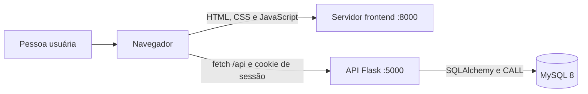

# TrailUp

## Apresentação do projeto

O **TrailUp** é uma aplicação web para descobrir trilhas, consultar percursos e checkpoints, avaliar experiências e organizar expedições.

- **Público-alvo:** pessoas que praticam trilhas, de iniciantes a grupos que organizam saídas.
- **Problema:** concentra informações sobre percursos, preparação e coordenação de expedições que normalmente ficam espalhadas por diferentes fontes.

### Integrantes

| Nome | Papel |
|---|---|
| Felipe Cornélio Leite | Frontend |
| Nikolas Ansur Proti Soares | Frontend |
| Miguel Seleme de Azevedo | Backend |
| Miguel Anthony de Oliveira | Backend |
| Lucca Freitas Leandro | BD + Infra |
| Pedro da Silva Brum | BD + Infra |

## Requisitos

Os itens abaixo correspondem às rotas e telas existentes. Os fluxos que usam procedures precisam de MySQL 8 com `procedures.sql` aplicado.

1. Buscar trilhas por texto — **[Consulta/Repository]** `GET /api/trails?q=...` — Home.
2. Filtrar por dificuldade — **[Consulta/Repository]** `GET /api/trails?difficulty=...` — Home.
3. Filtrar por distância, duração e nota média — **[Consulta/Repository]** `GET /api/trails?maxDistance=...&maxDuration=...&minRating=...` — Home.
4. Ordenar trilhas — **[Consulta/Repository]** `GET /api/trails?sort=...` — Home.
5. Encontrar trilhas próximas de coordenadas informadas — **[Consulta/Repository]** `GET /api/trails?lat=...&lon=...` — Home, botão “Trilhas próximas”.
6. Consultar detalhes e checkpoints de uma trilha — **[Consulta/Repository]** `GET /api/trails/<trail_id>` — Detalhe.
7. Consultar mapa do percurso — **[Consulta/Repository]** `GET /api/trails/<trail_id>` — Detalhe.
8. Consultar avaliações e nota média — **[Consulta/Repository]** `GET /api/trails/<trail_id>` — Detalhe.
9. Criar conta aceitando o termo — **[CRUD]** `POST /api/auth/register` — Cadastro.
10. Entrar — **[CRUD]** `POST /api/auth/login` — Login.
11. Encerrar sessão — **[CRUD]** `POST /api/auth/logout` — Navegação.
12. Adicionar trilha aos favoritos — **[CRUD]** `POST /api/trails/<trail_id>/favorite` — Cards e detalhe.
13. Remover trilha dos favoritos — **[CRUD]** `DELETE /api/trails/<trail_id>/favorite` — Cards e detalhe.
14. Consultar favoritos — **[Consulta/Repository]** `GET /api/favorites` — Favoritos.
15. Consultar expedições ativas, participantes e comentários — **[Consulta/Repository]** `GET /api/events` — Expedições.
16. Criar expedição — **[Consulta/Repository]** `POST /api/events` — Formulário de expedições.
17. Participar respeitando limite de vagas — **[Consulta/Repository]** `POST /api/events/<event_id>/participation` — Expedições.
18. Sair de expedição — **[CRUD]** `DELETE /api/events/<event_id>/participation` — Expedições.
19. Editar expedição própria — **[CRUD]** `PUT /api/events/<event_id>` — Expedições.
20. Cancelar expedição própria — **[CRUD]** `DELETE /api/events/<event_id>` — Expedições.
21. Comentar como participante confirmado — **[CRUD]** `POST /api/events/<event_id>/comments` — Expedições.
22. Publicar avaliação — **[CRUD]** `POST /api/trails/<trail_id>/reviews` — Detalhe.
23. Editar avaliação própria — **[CRUD]** `PUT /api/reviews/<review_id>` — Detalhe.
24. Excluir avaliação própria — **[CRUD]** `DELETE /api/reviews/<review_id>` — Detalhe.
25. Consultar histórico — **[Consulta/Repository]** `GET /api/history` — Perfil.
26. Registrar trilha concluída — **[CRUD]** `POST /api/history` — Detalhe.
27. Atualizar perfil — **[CRUD]** `PATCH /api/profile` — Perfil.
28. Reportar problema — **[CRUD]** `POST /api/reports` — Home, detalhe e expedições.
29. Consultar ranking — **[Consulta/Repository]** `GET /api/reports/ranking` — Ranking.
30. Consultar resumo pessoal — **[Consulta/Repository]** `GET /api/reports/summary` — Resumo.
31. Consultar checklist salvo — **[Consulta/Repository]** `GET /api/trails/<trail_id>/checklist-state` — Detalhe.
32. Marcar item do checklist — **[CRUD]** `PATCH /api/checklist/<item_id>` — Detalhe.
33. Exportar meus dados (portabilidade LGPD) — **[Consulta/Repository]** `GET /api/profile/export` — Perfil.

`[CRUD]` indica Service → Model. `[Consulta/Repository]` indica Service → Repository → procedure MySQL; algumas operações também gravam por Model.

## Funcionalidades

-  O sistema deve permitir buscar trilhas pelo nome ou localização. 
-  O sistema deve mostrar distância, duração e nível de dificuldade. 
-  O sistema deve exibir mapa específico para trilhas. 
-  O sistema deve permitir avaliações e comentários. 
-  O sistema deve permitir salvar trilhas favoritas. 
-  O sistema deve fornecer checklist de equipamentos. 
-  O sistema deve permitir criar eventos para trilhas. 
-  O sistema deve registrar histórico de trilhas realizadas.
- Editar/excluir avaliação própria
- Exibir nota média da trilha (calculada a partir de AVALIACAO)
- Editar perfil do usuário (nome, email, foto)
- Listar participantes confirmados de um evento (apenas nome)
- Ordenar/filtrar trilhas por distância, duração ou nota
- Comentários em eventos (participantes combinam detalhes)
- Trilhas próximas.
- Suporte a bugs, trilhas etc (botão para reportar)
- Botão “Concluir trilha”: registrar data, tempo e avaliação pessoal.
- Recuperação de senha: criar telas e envio do link; já existem métodos no serviço de usuários.
- Editar e cancelar eventos: disponibilizar ao organizador os recursos existentes no backend.
- Exportar meus dados (baixar um JSON no Perfil).


### Cinco casos de uso e respectivas telas

| Caso de uso | Tela | Captura |
|---|---|---|
| Buscar e filtrar trilhas | Home | `docs/img/home-busca.png` |
| Encontrar trilhas próximas | Home | `docs/img/trilhas-proximas.png` |
| Consultar mapa e checkpoints | Detalhe da trilha | `docs/img/detalhe-trilha.png` |
| Participar de expedição | Expedições | `docs/img/participar-expedicao.png` |
| Consultar ranking e resumo | Relatórios | `docs/img/relatorios.png` |

As imagens ainda precisam ser incluídas em `docs/img/`.

## Arquitetura

### Cliente-servidor

O frontend estático e a API rodam separadamente. O navegador servido em `:8000` faz requisições `fetch` à API Flask em `:5000`.



### Fluxo em camadas

```text
Tela → fetch → Rota Blueprint → Controller → Service → Model ou Repository → procedure MySQL → Banco
```

**CRUD simples:** Service valida o caso de uso e usa a Model para consultar ou persistir dados. **Consulta complexa:** Service chama Repository, que executa `CALL sp_...` e devolve os resultados.

### Diretórios

```text
backend/
  app.py
  controllers/       # controllers em classes por recurso
  routes/            # blueprints por recurso
  services/          # services por caso de uso
  models/            # models SQLAlchemy e CrudMixin
  repositories/      # consultas especializadas via procedures
  database/          # schema, migrações, procedures e seed
frontend/
  index.html
  config.js
  static/css/
  static/js/         # módulos separados por funcionalidade
docs/
  diagrama_de_classes.md
  fluxogramas/
```

- [Diagrama de classes](docs/diagrama_de_classes.md), em `docs/diagrama_de_classes.md`.
- Fluxogramas: [buscar trilhas](docs/fluxogramas/buscar_trilhas.md), [ranking](docs/fluxogramas/ranking.md), [participar de expedição](docs/fluxogramas/participar_evento.md), [criar expedição](docs/fluxogramas/criar_evento.md) e [exportar dados](docs/fluxogramas/exportar_dados.md).

## Banco de dados

### Procedures criadas

| Procedure | Parâmetros | Repository e método |
|---|---|---|
| `sp_buscar_trilhas` | `p_termo`, `p_dificuldade` | `TrilhaRepository.buscar` |
| `sp_filtrar_trilhas` | `p_distancia_max`, `p_duracao_max`, `p_nota_min`, `p_ordem` | `TrilhaRepository.listar_ordenadas` |
| `sp_medias_trilhas` | — | `TrilhaRepository.medias_avaliacao` |
| `sp_avaliacoes_trilha` | `p_id_trilha` | `TrilhaRepository.avaliacoes_com_autores` |
| `sp_historico_usuario` | `p_id_usuario` | `HistoricoRepository.listar_por_usuario` |
| `sp_checkpoints_trilha` | `p_id_trilha` | `CheckpointRepository.listar_por_trilha` |
| `sp_primeiro_checkpoint_valido` | `p_id_trilha` | `CheckpointRepository.primeiro_valido_por_trilha` |
| `sp_eventos_por_trilha` | `p_id_trilha` | `EventoRepository.listar_por_trilha` |
| `sp_contar_participantes_evento` | `p_id_evento` | `EventoRepository.contar_participantes` |
| `sp_detalhes_eventos` | `p_ids` (JSON) | `EventoRepository.detalhes_em_lote` |
| `sp_resumo_usuario` | `p_id_usuario` | `RelatorioRepository.resumo_usuario` |
| `sp_ranking_usuarios` | `p_limite` | `RelatorioRepository.ranking_usuarios` |
| `sp_favoritos_usuario` | `p_id_usuario` | `FavoritoRepository.listar_por_usuario` |
| `sp_eventos_ativos` | — | `EventoRepository.listar_ativos` |
| `sp_checklist_usuario` | `p_id_usuario`, `p_id_trilha` | `ChecklistRepository.listar_marcados` |
| `sp_trilhas_proximas` | `p_latitude`, `p_longitude`, `p_limite` | `TrilhaRepository.trilhas_proximas` |

As procedures estão em `backend/database/procedures.sql`.

### Models e Repositories

As Models em `backend/models/` são `Usuario`, `Trilha`, `Evento`, `EventoTrilha`, `ParticipanteEvento`, `ComentarioEvento`, `Avaliacao`, `Favorito`, `HistoricoTrilha`, `Checkpoint`, `ChecklistItem`, `ChecklistUsuario`, `TokenRecuperacao` e `Denuncia`. Elas herdam de `CrudMixin` e `db.Model` e oferecem `to_dict()` e consultas simples por chave/filtro.

| Repository | Responsabilidade |
|---|---|
| `TrilhaRepository` | Busca, filtros, avaliações com autores, médias, checkpoints válidos e proximidade. |
| `EventoRepository` | Listagens, participantes, comentários, contagem e detalhes de eventos. |
| `CheckpointRepository` | Checkpoints de trilha e primeiro checkpoint válido. |
| `FavoritoRepository` | Lista favoritos com os dados necessários aos cards. |
| `HistoricoRepository` | Histórico do usuário com nome da trilha. |
| `ChecklistRepository` | Marcações persistidas por usuário e trilha. |
| `RelatorioRepository` | Ranking e resumo agregado. |

### Criar o banco

Requer MySQL 8. Na raiz do repositório, com o cliente `mysql` disponível:

```powershell
Get-Content backend/database/create_database.sql -Raw | mysql -u root -p
Get-Content backend/database/procedures.sql -Raw | mysql -u root -p
Get-Content backend/database/seed_dados_exemplo.sql -Raw | mysql -u root -p
```

O `create_database.sql` também cria o usuário da aplicação e concede as permissões necessárias. O bloco executado é:

```sql
CREATE USER 'trailup'@'localhost'
IDENTIFIED WITH caching_sha2_password BY '';

GRANT SELECT, INSERT, UPDATE, DELETE, EXECUTE
ON trilhas_db.* TO 'trailup'@'localhost';
```

Configure a mesma senha no `DATABASE_URL` do arquivo `backend/.env` (em branco no exemplo acima) antes de iniciar a aplicação.

Em banco existente, aplique também as migrações `backend/database/migracao_01_termo_checklist_token.sql` e `backend/database/migracao_02_remover_tabelas_sem_fluxo.sql`, conforme o estado do schema.

## API

Base local: `http://localhost:5000/api`. As respostas usam JSON e a sessão usa cookie.

| Método | Rota | Autenticação | Descrição |
|---|---|---|---|
| GET | `/session` | Não | Sessão atual. |
| POST | `/auth/register` | Não | Cadastro. |
| POST | `/auth/login` | Não | Autenticação. |
| POST | `/auth/logout` | Não | Encerramento da sessão. |
| POST | `/auth/password-reset` | Não | Solicita recuperação; envio depende de SMTP. |
| POST | `/auth/password-reset/confirm` | Não | Redefine senha com token. |
| GET | `/trails` | Não | Busca e filtros de trilhas. |
| GET | `/trails/<trail_id>` | Não | Detalhe, checkpoints e avaliações. |
| POST | `/trails/<trail_id>/favorite` | Sim | Adiciona favorito. |
| DELETE | `/trails/<trail_id>/favorite` | Sim | Remove favorito. |
| GET | `/favorites` | Sim | Favoritos do usuário. |
| GET | `/events` | Não | Expedições ativas. |
| POST | `/events` | Sim | Cria expedição. |
| POST | `/events/<event_id>/participation` | Sim | Participa. |
| DELETE | `/events/<event_id>/participation` | Sim | Sai. |
| PUT | `/events/<event_id>` | Sim | Atualiza expedição própria. |
| DELETE | `/events/<event_id>` | Sim | Cancela expedição própria. |
| POST | `/events/<event_id>/comments` | Sim | Comenta como participante. |
| POST | `/trails/<trail_id>/reviews` | Sim | Publica avaliação. |
| PUT | `/reviews/<review_id>` | Sim | Atualiza avaliação própria. |
| DELETE | `/reviews/<review_id>` | Sim | Exclui avaliação própria. |
| GET | `/history` | Sim | Consulta histórico. |
| POST | `/history` | Sim | Registra trilha concluída. |
| PATCH | `/profile` | Sim | Atualiza perfil. |
| GET | `/profile/export` | Sim | Exporta os dados do usuário em JSON. |
| POST | `/reports` | Sim | Registra problema. |
| GET | `/reports/ranking` | Não | Ranking da comunidade. |
| GET | `/reports/summary` | Sim | Resumo pessoal. |
| GET | `/trails/<trail_id>/checklist-state` | Sim | Marcações do checklist. |
| PATCH | `/checklist/<item_id>` | Sim | Salva marcação. |

A rota pública `/termo-consentimento` responde 404 até que o PDF correto seja fornecido.

## Tecnologias

- **Backend:** Python, Flask 3, Flask-SQLAlchemy, SQLAlchemy e MySQL 8 com PyMySQL.
- **Frontend:** HTML, CSS e JavaScript.
- **Mapa:** MapLibre GL e dados/tiles do OpenStreetMap; requer internet.

## Como executar

### Requisitos

- Python 3.10 ou superior.
- MySQL 8 ou superior.
- Navegador moderno.

### Backend — porta 5000

No primeiro terminal:

```powershell
cd backend
python -m venv .venv
.venv\Scripts\Activate.ps1
pip install -r requirements.txt
Copy-Item .env.example .env
```

Configure `DATABASE_URL`, `SECRET_KEY` e `FRONTEND_ORIGIN=http://localhost:8000` no arquivo `.env` local. Não publique credenciais ou senhas.

```powershell
python app.py
```

### Frontend — porta 8000

Em outro terminal, na raiz do repositório:

```powershell
cd frontend
python -m http.server 8000
```

Abra `http://localhost:8000`. `frontend/config.js` aponta por padrão para `http://localhost:5000/api`. O modelo de variáveis do backend está em [backend/.env.example](backend/.env.example).

## Apresentação e demonstração

- [Slides e apresentação](docs/apresentacao.md).
- [Roteiro de vídeo de até 2 minutos](docs/roteiro_video.md).
