# Diagrama de classes do TrailUp

Diagrama das Models registradas em `backend/models/__init__.py`. Cada Model herda `CrudMixin` e `db.Model`; os relacionamentos abaixo refletem as chaves estrangeiras e tabelas de associação do schema.

```mermaid
classDiagram
    class db.Model
    class CrudMixin {
      +salvar()
      +atualizar()
      +deletar()
      +listar_todos()
      +buscar_por_id()
    }
    class Usuario { idUsuario; nome; email; senha; termoAceitoEm; versaoTermo }
    class Trilha { idTrilha; nome; localizacao; distancia; duracao; dificuldade }
    class Avaliacao { idAvaliacao; idUsuario; idTrilha; nota; comentario }
    class Favorito { idFavorito; idUsuario; idTrilha; dataSalvo }
    class HistoricoTrilha { idHistorico; idUsuario; idTrilha; dataRealizacao }
    class Checkpoint { idCheckpoint; idTrilha; latitude; longitude }
    class ChecklistItem { idChecklistItem; idTrilha; descricao; obrigatorio }
    class ChecklistUsuario { idUsuario; idChecklistItem; marcado }
    class Evento { idEvento; idCriador; titulo; data; vagas; tipo }
    class EventoTrilha { idEvento; idTrilha }
    class ParticipanteEvento { idEvento; idUsuario }
    class ComentarioEvento { idComentario; idEvento; idUsuario; texto }
    class Denuncia { idDenuncia; idUsuarioDenunciante; categoria; descricao }
    class TokenRecuperacao { idToken; idUsuario; tokenHash; expiraEm; usadoEm }
    db.Model <|-- Usuario
    CrudMixin <|.. Usuario
    db.Model <|-- Trilha
    CrudMixin <|.. Trilha
    db.Model <|-- Avaliacao
    CrudMixin <|.. Avaliacao
    db.Model <|-- Favorito
    CrudMixin <|.. Favorito
    db.Model <|-- HistoricoTrilha
    CrudMixin <|.. HistoricoTrilha
    db.Model <|-- Checkpoint
    CrudMixin <|.. Checkpoint
    db.Model <|-- ChecklistItem
    CrudMixin <|.. ChecklistItem
    db.Model <|-- ChecklistUsuario
    CrudMixin <|.. ChecklistUsuario
    db.Model <|-- Evento
    CrudMixin <|.. Evento
    db.Model <|-- EventoTrilha
    CrudMixin <|.. EventoTrilha
    db.Model <|-- ParticipanteEvento
    CrudMixin <|.. ParticipanteEvento
    db.Model <|-- ComentarioEvento
    CrudMixin <|.. ComentarioEvento
    db.Model <|-- Denuncia
    CrudMixin <|.. Denuncia
    db.Model <|-- TokenRecuperacao
    CrudMixin <|.. TokenRecuperacao
    Usuario "1" --> "0..*" Avaliacao : publica
    Trilha "1" --> "0..*" Avaliacao : recebe
    Usuario "1" --> "0..*" Favorito : salva
    Trilha "1" --> "0..*" Favorito : favorita
    Usuario "1" --> "0..*" HistoricoTrilha : registra
    Trilha "1" --> "0..*" HistoricoTrilha : concluida
    Trilha "1" --> "0..*" Checkpoint : contem
    Trilha "1" --> "0..*" ChecklistItem : recomenda
    Usuario "1" --> "0..*" ChecklistUsuario : marca
    ChecklistItem "1" --> "0..*" ChecklistUsuario : marcado_por
    Usuario "1" --> "0..*" Evento : organiza
    Evento "1" --> "0..*" ParticipanteEvento : recebe
    Usuario "1" --> "0..*" ParticipanteEvento : participa
    Evento "1" --> "0..*" ComentarioEvento : recebe
    Usuario "1" --> "0..*" ComentarioEvento : comenta
    Evento "1" --> "0..*" EventoTrilha : relaciona
    Trilha "1" --> "0..*" EventoTrilha : relacionada
    Usuario "1" --> "0..*" Denuncia : envia
    Evento "0..1" --> "0..*" Denuncia : denunciado
    Trilha "0..1" --> "0..*" Denuncia : denunciada
    Usuario "1" --> "0..*" TokenRecuperacao : recebe
```

`Favorito`, `HistoricoTrilha`, `EventoTrilha`, `ParticipanteEvento` e `ChecklistUsuario` representam vínculos persistidos em tabelas próprias.
