# Diagrama de classes do TrailUp

Diagrama derivado das classes `db.Model` atualmente registradas em `backend/models/__init__.py`. Todas herdam as operações CRUD comuns de `CrudMixin`; `Usuario` e `Trilha` também declaram alguns métodos próprios. `Foto` e `Notificacao` continuam no schema e nos Models porque o seed de demonstração ainda cria esses registros, embora não tenham tela/API de uso atualmente.

```mermaid
classDiagram
    class CrudMixin {
      +salvar()
      +atualizar()
      +deletar()
      +listar_todos()
      +buscar_por_id()
    }
    class Usuario { idUsuario; nome; email; senha; termoAceitoEm; versaoTermo }
    class Trilha { idTrilha; nome; localizacao; distancia; duracao; dificuldade }
    class Avaliacao { idAvaliacao; idUsuario; idTrilha; nota; comentario }
    class Favorito { idUsuario; idTrilha }
    class HistoricoTrilha { idUsuario; idTrilha; dataRealizacao }
    class Checkpoint { idCheckpoint; idTrilha; latitude; longitude }
    class ChecklistItem { idChecklistItem; idTrilha; descricao; obrigatorio }
    class ChecklistUsuario { idUsuario; idChecklistItem; marcado }
    class Evento { idEvento; idCriador; titulo; data; vagas; tipo }
    class EventoTrilha { idEvento; idTrilha }
    class ParticipanteEvento { idEvento; idUsuario }
    class ComentarioEvento { idComentario; idEvento; idUsuario; texto }
    class Denuncia { idDenuncia; idUsuario; categoria; descricao }
    class RegistroRealizado { idRegistro; latitude; longitude; horario; idHistorico }
    class TokenRecuperacao { idToken; idUsuario; tokenHash; expiraEm; usadoEm }
    class Foto { idFoto; idTrilha; url; legenda }
    class Notificacao { idNotificacao; idUsuario; idEvento; mensagem; lida }
    CrudMixin <|.. Usuario
    CrudMixin <|.. Trilha
    CrudMixin <|.. Avaliacao
    CrudMixin <|.. Favorito
    CrudMixin <|.. HistoricoTrilha
    CrudMixin <|.. Checkpoint
    CrudMixin <|.. ChecklistItem
    CrudMixin <|.. ChecklistUsuario
    CrudMixin <|.. Evento
    CrudMixin <|.. EventoTrilha
    CrudMixin <|.. ParticipanteEvento
    CrudMixin <|.. ComentarioEvento
    CrudMixin <|.. Denuncia
    CrudMixin <|.. RegistroRealizado
    CrudMixin <|.. TokenRecuperacao
    CrudMixin <|.. Foto
    CrudMixin <|.. Notificacao
    Usuario "1" --> "0..*" Avaliacao
    Trilha "1" --> "0..*" Avaliacao
    Usuario "1" --> "0..*" Favorito
    Trilha "1" --> "0..*" Favorito
    Usuario "1" --> "0..*" HistoricoTrilha
    Trilha "1" --> "0..*" HistoricoTrilha
    Trilha "1" --> "0..*" Checkpoint
    Trilha "1" --> "0..*" ChecklistItem
    Usuario "1" --> "0..*" ChecklistUsuario
    ChecklistItem "1" --> "0..*" ChecklistUsuario
    Usuario "1" --> "0..*" Evento : cria
    Evento "1" --> "0..*" ParticipanteEvento
    Usuario "1" --> "0..*" ParticipanteEvento
    Evento "1" --> "0..*" ComentarioEvento
    Usuario "1" --> "0..*" ComentarioEvento
    Evento "1" --> "0..*" EventoTrilha
    Trilha "1" --> "0..*" EventoTrilha
    Usuario "1" --> "0..*" Denuncia
    Usuario "1" --> "0..*" TokenRecuperacao
    Trilha "1" --> "0..*" Foto
    Usuario "1" --> "0..*" Notificacao
    Evento "0..1" --> "0..*" Notificacao
```

Os vínculos de associação usam as chaves estrangeiras declaradas nos Models. `EventoTrilha`, `ParticipanteEvento`, `Favorito`, `HistoricoTrilha` e `ChecklistUsuario` representam vínculos persistidos em tabelas próprias.
