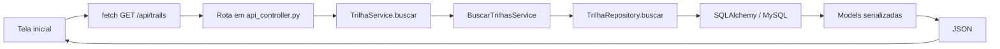

# Fluxograma — buscar trilhas

> Estado atual: busca textual e filtro simples usam `TrilhaRepository` com ORM. Ordenação/filtros agregados também possuem procedure no MySQL através de `RelatorioRepository`, mas a interface não encaminha essas opções por esse caminho em todos os casos. O cálculo de proximidade segue no `TrilhaService` em Python.

A busca não passa hoje por uma classe Controller e não chama `sp_filtrar_trilhas`; registrar essa diferença evita apresentar como concluída uma cadeia que ainda não existe.
