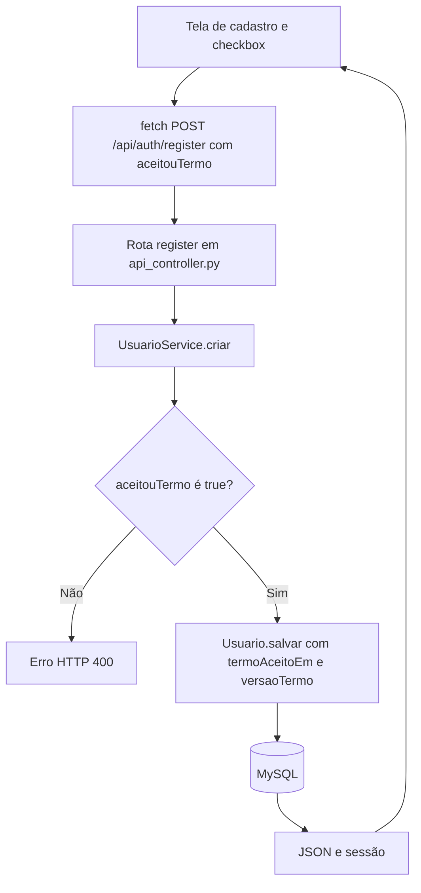

# Fluxograma — cadastrar usuário com aceite

A aplicação registra a decisão e a versão do termo. O arquivo PDF correto ainda não foi fornecido, portanto a rota do documento não pode ser considerada validada.
