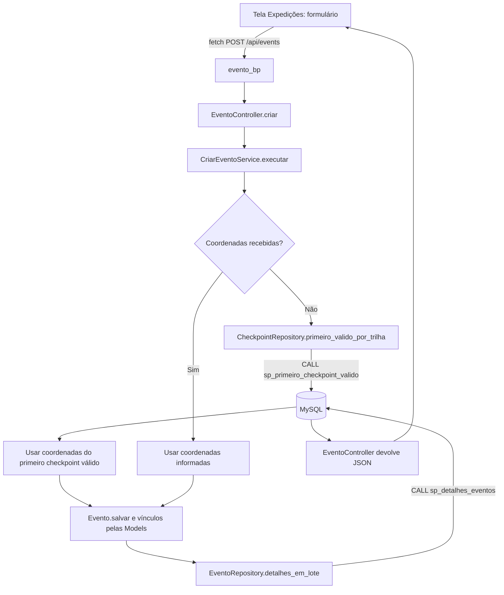

# Fluxograma — criar expedição

Se a trilha não tiver checkpoint válido, a expedição ainda pode ser criada sem coordenadas herdadas. A resposta é montada com os detalhes do evento consultados pelo Repository.
