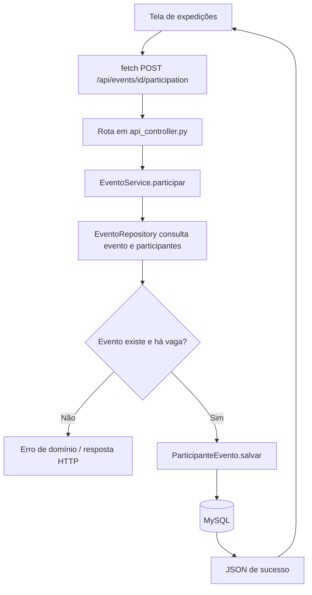

# Fluxograma — participar de expedição

O caminho atual utiliza ORM no repository; `sp_contar_participantes_evento` ainda não existe em `procedures.sql`. A validação de vagas é implementada no Service e não deve ser confundida com uma procedure já implantada.
