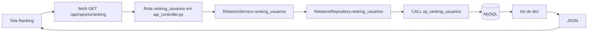

# Fluxograma — ranking de trilheiros

A rota e tela existem. A execução da procedure precisa ser validada com um servidor MySQL; a verificação disponível neste ambiente foi por chamadas simuladas ao controller.
